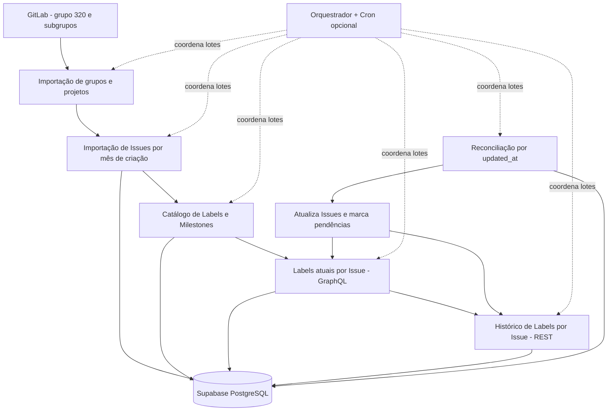

# Flow Analytics — Contexto técnico da integração GitLab ↔ Supabase

> **Finalidade:** referência técnica versionável para o repositório do Flow Analytics. Consolida o desenho do banco, as Edge Functions e os contratos de sincronização construídos na refatoração.
>
> **Base documental:** SQL de criação das tabelas `*_gitlab`, migration `current_labels`, SQL de orquestração e versões dos `index.ts` produzidos durante o projeto. **Não constitui introspecção em tempo real do banco de produção**. Verificar migrations e deploys efetivamente aplicados.

## 1. Escopo, decisões e situação

- **Produto:** Flow Analytics, aplicação de gestão de Sprints, projetos e indicadores de engenharia de software.
- **Origem:** GitLab self-hosted `https://gitlab.insidesistemas.com.br/`.
- **Grupo-raiz GitLab:** `320`, incluindo projetos de subgrupos pertencentes ao grupo e acessíveis pelo token.
- **Integração Supabase:** `1cfb42c7-3676-4045-b63c-2ad876812575` (ID interno **fixo** nas funções atuais).
- **Destino:** PostgreSQL do Supabase, tabelas em `public`, sufixo `_gitlab`.
- **Implementação:** Supabase Edge Functions em TypeScript/Deno, REST e GraphQL GitLab, execução por lotes e checkpoints no PostgreSQL.
- **Abordagem:** novo conjunto de tabelas e funções; não reutiliza as antigas tabelas/funções da primeira integração.
- **Escopo de “board/projeto”:** para este fluxo, o vínculo de origem é **Projeto GitLab**, não Board Kanban. Não foram criadas tabelas de Board/coluna.
- **Carga inicial de Issues:** `state=all`, por **data de criação**, mês a mês durante **2026**, via endpoint de Issues de grupo.
- **Reconciliação:** por **data de atualização** (`updated_after` / `updated_before`), inicialmente desde 2026-01-01; pode trazer Issues criadas antes de 2026 que sofreram alterações em 2026.
- **Status de implantação:** tabelas iniciais foram informadas como criadas pelo usuário; algumas Edge Functions foram testadas durante a conversa. O deploy completo das revisões, da migration `current_labels` e do Cron **não foi confirmado**. Não declarar sincronização integral ou automação ativa sem checagem.

### Distinções de domínio

- `issues_gitlab.gitlab_id`: ID externo/global da Issue na instância GitLab. `issues_gitlab.iid`: número local da Issue dentro do projeto (`project_id` interno referencia `projects_gitlab`).
- `issues_gitlab` guarda o **estado atual**; `issue_labels_gitlab` guarda Labels **atuais**; `label_events_gitlab` guarda o **histórico de eventos** `add`/`remove`.
- O mesmo nome de Label pode existir em diferentes escopos. **Identificar pela chave GitLab**, nunca associar apenas pelo nome.
- `issue_assignees_gitlab` registra responsáveis **atuais**; não é uma trilha histórica de responsáveis.
- `created_at_gitlab` e `updated_at_gitlab` distinguem datas do GitLab de `synced_at`/`imported_at` (datas da coleta no Supabase).

## 2. Fluxo de importação e sincronização



A ordem operacional do **orquestrador atual** é: `projects` → `issues` → `catalog_details` → `reconcile` → `current_labels` → `label_events` → `idle`. A ilustração acima apresenta as dependências de dados, não a ordem literal de cada tick.

### 2.1 Inventário das Edge Functions

| Edge Function (nome de deploy) | Operação principal | Principais tabelas escritas | Checkpoint / observações |
|---|---|---|---|
| `projects_gitlab_import_new` | Importa grupo-raiz/subgrupos e projetos, com paginação | `groups_gitlab`, `projects_gitlab`, `sync_cursors_gitlab` | `sync_type='catalog'`, cursor **global**; até 100 projetos por página. |
| `issues_gitlab_new` | `GET /api/v4/groups/320/issues`, inclui abertas e fechadas, segmenta por mês de criação em 2026 | `issues_gitlab`, `users_gitlab`, `milestones_gitlab`, `issue_assignees_gitlab`, `sync_cursors_gitlab` | `sync_type='issues'` global; referência do código: `PER_PAGE=100`, até 12 páginas/70 s por requisição (o deploy real pode ter parâmetros diferentes). |
| `gitlab-import-catalog-details` | Importa Labels/Milestones, incluindo itens herdados, por projeto | `labels_gitlab`, `milestones_gitlab`, `sync_cursors_gitlab` | `sync_type='catalog'` **por projeto**; até 10 páginas/60 s. |
| `gitlab-import-issue-labels` | Consulta GraphQL da Issue para resolver IDs exatos das Labels atuais | `labels_gitlab`, `issue_labels_gitlab`, `issues_gitlab`, `sync_cursors_gitlab` | `sync_type='current_labels'` **após migration**; até 15 Issues/55 s; grava `labels_synced_at`. |
| `gitlab-import-label-events` | Consulta histórico `resource_label_events` com eventos `add` e `remove` | `label_events_gitlab`, `labels_gitlab`, `users_gitlab`, `issues_gitlab`, `sync_cursors_gitlab` | `sync_type='label_events'`; até 8 páginas de 100 eventos/52 s; grava `label_events_synced_at` ao completar a Issue. |
| `gitlab-reconcile-issues` | Busca Issues novas/alteradas por janela incremental e identifica pendências de Labels | `issues_gitlab`, `users_gitlab`, `milestones_gitlab`, `issue_assignees_gitlab`, `sync_cursors_gitlab` | `sync_type='reconcile'`; até 4 páginas de 50/50 s; janela inicial desde 2026-01-01, sobreposição de 10 min nas seguintes. |
| `gitlab-sync-orchestrator` | Coordena fases, chamadas de lotes, retentativas e ciclos | `orchestrator_state_gitlab`, `orchestrator_runs_gitlab`; lê `sync_cursors_gitlab`, `issues_gitlab`, `projects_gitlab` | Um worker/lote por requisição; fase `idle` por 15 min entre ciclos completos; Cron a cada minuto é **opcional**. |

> **Nomes:** algumas versões de código foram distribuídas em pastas `gitlab-import-projects` e `gitlab-import-issues`, mas os nomes de deploy usados no orquestrador são `projects_gitlab_import_new` e `issues_gitlab_new`. Quando necessário, configurar `ORCH_FN_*` para os nomes efetivamente publicados.

### 2.2 APIs GitLab efetivamente previstas no código

| Recurso | Endpoint / método | Observações |
|---|---|---|
| Grupo e projetos | `GET /api/v4/groups/:group_id`, `GET /api/v4/groups/:group_id/projects` | Paginação e inclusão de subgrupos de acordo com a configuração da chamada. |
| Issues do grupo | `GET /api/v4/groups/:group_id/issues` | `state=all`, filtros `created_after`/`created_before` para carga inicial e `updated_after`/`updated_before` na reconciliação. |
| Labels do projeto | `GET /api/v4/projects/:id/labels` | `include_ancestor_groups=true` na importação de catálogos. |
| Milestones do projeto | `GET /api/v4/projects/:id/milestones` | `include_ancestors=true` na importação de catálogos. |
| Labels atuais da Issue | `POST /api/graphql` | Consulta `project.issue.labels`, com IDs globais que permitem determinar o ID real da Label e evitar ambiguidade de nomes. |
| Histórico de Labels | `GET /api/v4/projects/:id/issues/:iid/resource_label_events` | `id`, `action`, `label`, `user`, `created_at`; paginação por Issue. |

### 2.3 Contrato HTTP e continuidade

- Workers recebem `POST` com `{}`; `integration_id`, `group_id`, mês e página são definidos no código/configuração e/ou cursor.
- A conclusão é indicada por `complete: true`; quando `resume_required: true`, outras execuções são necessárias.
- Não disparar trabalhadores manualmente em paralelo com o orquestrador; os workers utilizam cursores lineares sem lease próprio.
- Reconciliar **não** equivale a reprocessar Labels: a reconciliação coloca `labels_synced_at` e/ou `label_events_synced_at` como `NULL` ao detectar necessidade; o orquestrador deve acionar os importadores posteriormente.
- A versão atual dos importadores de Labels faz **varredura completa** ao reiniciar seus cursores, em vez de consultar somente Issues pendentes. Há custo adicional e espaço para otimização.

## 3. Modelo de dados PostgreSQL

**Convenções:** schema `public`; chaves internas `uuid`; identificadores do GitLab `bigint`; datas/hora `timestamptz`; snapshots `jsonb`; tabelas de associação usam PK composta. As definições de colunas abaixo foram extraídas do SQL de criação, não inferidas do uso no aplicativo.

### 3.1 Relacionamentos

- `integrations_gitlab` (1) → (N) `groups_gitlab`, `projects_gitlab`, `users_gitlab`, `milestones_gitlab`, `labels_gitlab`, `issues_gitlab`, `label_events_gitlab`, `sync_jobs_gitlab` e `sync_cursors_gitlab`.
- `groups_gitlab.parent_group_id` → `groups_gitlab.id` (hierarquia de subgrupos).
- `projects_gitlab.group_id` → `groups_gitlab.id`.
- `issues_gitlab.project_id` → `projects_gitlab.id`.
- `issues_gitlab.author_id`, `issues_gitlab.primary_assignee_id` → `users_gitlab.id`.
- `issues_gitlab.milestone_id` → `milestones_gitlab.id`.
- `issue_assignees_gitlab` conecta Issues ↔ Usuários (N:N).
- `issue_labels_gitlab` conecta Issues ↔ Labels (N:N).
- `label_events_gitlab.issue_id` → `issues_gitlab.id`; `label_id` → `labels_gitlab.id` (nullable); `actor_user_id` → `users_gitlab.id` (nullable).
- `orchestrator_state_gitlab.integration_id` é PK/FK para `integrations_gitlab.id`; `orchestrator_runs_gitlab.integration_id` é FK.

### `integrations_gitlab`

Cadastro da conexão GitLab por empresa. A URL e o vínculo com a empresa ficam aqui; o token é um secret de backend.

| Coluna | Definição SQL |
|---|---|
| `id` | `uuid primary key default gen_random_uuid()` |
| `company_id` | `uuid not null` |
| `name` | `text not null` |
| `base_url` | `text not null` |
| `is_active` | `boolean not null default true` |
| `credential_secret_name` | `text` |
| `created_at` | `timestamptz not null default now()` |
| `updated_at` | `timestamptz not null default now()` |
| `last_successful_sync_at` | `timestamptz` |

**Restrições e chaves:** UNIQUE (`company_id`, `base_url`). `company_id` sem FK no SQL-base (integração com tabela de empresas pendente).

### `groups_gitlab`

Grupos e subgrupos, incluindo a hierarquia por `parent_group_id`.

| Coluna | Definição SQL |
|---|---|
| `id` | `uuid primary key default gen_random_uuid()` |
| `integration_id` | `uuid not null references public.integrations_gitlab(id) on delete cascade` |
| `gitlab_id` | `bigint not null` |
| `parent_group_id` | `uuid references public.groups_gitlab(id) on delete set null` |
| `name` | `text not null` |
| `full_path` | `text not null` |
| `web_url` | `text` |
| `synced_at` | `timestamptz not null default now()` |
| `raw_payload` | `jsonb` |

**Restrições e chaves:** UNIQUE (`integration_id`, `gitlab_id`). Auto-relacionamento `parent_group_id`.

### `projects_gitlab`

Projetos GitLab pertencentes ao grupo 320/subgrupos. `import_enabled` define elegibilidade para importação.

| Coluna | Definição SQL |
|---|---|
| `id` | `uuid primary key default gen_random_uuid()` |
| `integration_id` | `uuid not null references public.integrations_gitlab(id) on delete cascade` |
| `gitlab_id` | `bigint not null` |
| `group_id` | `uuid references public.groups_gitlab(id) on delete set null` |
| `name` | `text not null` |
| `path_with_namespace` | `text not null` |
| `namespace_full_path` | `text` |
| `web_url` | `text` |
| `archived` | `boolean not null default false` |
| `marked_for_deletion_on` | `date` |
| `last_activity_at` | `timestamptz` |
| `import_enabled` | `boolean not null default true` |
| `synced_at` | `timestamptz not null default now()` |
| `raw_payload` | `jsonb` |

**Restrições e chaves:** UNIQUE (`integration_id`, `gitlab_id`).

### `users_gitlab`

Identidade de usuários GitLab referenciados em Issues e eventos.

| Coluna | Definição SQL |
|---|---|
| `id` | `uuid primary key default gen_random_uuid()` |
| `integration_id` | `uuid not null references public.integrations_gitlab(id) on delete cascade` |
| `gitlab_id` | `bigint not null` |
| `name` | `text not null` |
| `username` | `text` |
| `avatar_url` | `text` |
| `web_url` | `text` |
| `state` | `text` |
| `synced_at` | `timestamptz not null default now()` |

**Restrições e chaves:** UNIQUE (`integration_id`, `gitlab_id`).

### `milestones_gitlab`

Milestones, de projeto ou grupo, usadas nas Issues.

| Coluna | Definição SQL |
|---|---|
| `id` | `uuid primary key default gen_random_uuid()` |
| `integration_id` | `uuid not null references public.integrations_gitlab(id) on delete cascade` |
| `gitlab_id` | `bigint not null` |
| `project_id` | `uuid references public.projects_gitlab(id) on delete set null` |
| `group_id` | `uuid references public.groups_gitlab(id) on delete set null` |
| `title` | `text not null` |
| `state` | `text` |
| `start_date` | `date` |
| `due_date` | `date` |
| `synced_at` | `timestamptz not null default now()` |

**Restrições e chaves:** UNIQUE (`integration_id`, `gitlab_id`).

### `labels_gitlab`

Catálogo de Labels identificado pelo ID GitLab, permitindo Labels homônimas.

| Coluna | Definição SQL |
|---|---|
| `id` | `uuid primary key default gen_random_uuid()` |
| `integration_id` | `uuid not null references public.integrations_gitlab(id) on delete cascade` |
| `gitlab_id` | `bigint not null` |
| `name` | `text not null` |
| `color` | `text` |
| `description` | `text` |
| `synced_at` | `timestamptz not null default now()` |

**Restrições e chaves:** UNIQUE (`integration_id`, `gitlab_id`). Não impor unicidade por nome.

### `issues_gitlab`

Estado consolidado da Issue, vínculo com projeto, datas, atribuição principal e payload de origem.

| Coluna | Definição SQL |
|---|---|
| `id` | `uuid primary key default gen_random_uuid()` |
| `integration_id` | `uuid not null references public.integrations_gitlab(id) on delete cascade` |
| `project_id` | `uuid not null references public.projects_gitlab(id) on delete cascade` |
| `gitlab_id` | `bigint not null` |
| `iid` | `bigint not null` |
| `title` | `text not null` |
| `state` | `text not null check (state in ('opened','closed'))` |
| `issue_type` | `text` |
| `author_id` | `uuid references public.users_gitlab(id) on delete set null` |
| `primary_assignee_id` | `uuid references public.users_gitlab(id) on delete set null` |
| `milestone_id` | `uuid references public.milestones_gitlab(id) on delete set null` |
| `created_at_gitlab` | `timestamptz not null` |
| `updated_at_gitlab` | `timestamptz` |
| `closed_at` | `timestamptz` |
| `web_url` | `text` |
| `labels_synced_at` | `timestamptz` |
| `label_events_synced_at` | `timestamptz` |
| `synced_at` | `timestamptz not null default now()` |
| `raw_payload` | `jsonb` |

**Restrições e chaves:** UNIQUE (`integration_id`, `gitlab_id`) e UNIQUE (`project_id`, `iid`). CHECK `state IN ('opened','closed')`.

### `issue_assignees_gitlab`

Relação N:N de responsáveis atuais da Issue; não representa histórico de atribuições.

| Coluna | Definição SQL |
|---|---|
| `issue_id` | `uuid not null references public.issues_gitlab(id) on delete cascade` |
| `user_id` | `uuid not null references public.users_gitlab(id) on delete cascade` |

**Restrições e chaves:** PK composta (`issue_id`, `user_id`).

### `issue_labels_gitlab`

Relação N:N das Labels atualmente associadas à Issue; não representa histórico.

| Coluna | Definição SQL |
|---|---|
| `issue_id` | `uuid not null references public.issues_gitlab(id) on delete cascade` |
| `label_id` | `uuid not null references public.labels_gitlab(id) on delete cascade` |

**Restrições e chaves:** PK composta (`issue_id`, `label_id`).

### `label_events_gitlab`

Histórico de eventos de adição/remoção de Label e respectivos instantes e atores.

| Coluna | Definição SQL |
|---|---|
| `id` | `uuid primary key default gen_random_uuid()` |
| `integration_id` | `uuid not null references public.integrations_gitlab(id) on delete cascade` |
| `issue_id` | `uuid not null references public.issues_gitlab(id) on delete cascade` |
| `gitlab_event_id` | `bigint not null` |
| `label_id` | `uuid references public.labels_gitlab(id) on delete set null` |
| `label_gitlab_id` | `bigint` |
| `label_name_snapshot` | `text` |
| `action` | `text not null check(action in ('add','remove'))` |
| `actor_user_id` | `uuid references public.users_gitlab(id) on delete set null` |
| `occurred_at` | `timestamptz not null` |
| `imported_at` | `timestamptz not null default now()` |
| `raw_payload` | `jsonb` |

**Restrições e chaves:** UNIQUE (`integration_id`, `gitlab_event_id`). CHECK `action IN ('add','remove')`.

### `sync_jobs_gitlab`

Tabela prevista para jobs de importação; não é a principal estrutura usada pelo orquestrador atual.

| Coluna | Definição SQL |
|---|---|
| `id` | `uuid primary key default gen_random_uuid()` |
| `integration_id` | `uuid not null references public.integrations_gitlab(id) on delete cascade` |
| `project_id` | `uuid references public.projects_gitlab(id) on delete cascade` |
| `issue_id` | `uuid references public.issues_gitlab(id) on delete cascade` |
| `job_type` | `text not null check(job_type in ('catalog','issues','label_events','reconcile'))` |
| `status` | `text not null default 'pending' check(status in ('pending','running','succeeded','failed','cancelled'))` |
| `attempt_count` | `integer not null default 0 check(attempt_count >= 0)` |
| `cursor` | `jsonb` |
| `records_processed` | `integer not null default 0 check(records_processed >= 0)` |
| `error_message` | `text` |
| `created_at` | `timestamptz not null default now()` |
| `started_at` | `timestamptz` |
| `finished_at` | `timestamptz` |

**Restrições e chaves:** CHECK `job_type IN ('catalog','issues','label_events','reconcile')`; `status IN ('pending','running','succeeded','failed','cancelled')`; contadores ≥ 0.

### `sync_cursors_gitlab`

Checkpoints de importação por integração/tipo de sincronização, opcionalmente por projeto.

| Coluna | Definição SQL |
|---|---|
| `id` | `uuid primary key default gen_random_uuid()` |
| `integration_id` | `uuid not null references public.integrations_gitlab(id) on delete cascade` |
| `project_id` | `uuid references public.projects_gitlab(id) on delete cascade` |
| `sync_type` | `text not null check(sync_type in ('catalog','issues','label_events','reconcile'))` |
| `last_successful_at` | `timestamptz` |
| `cursor` | `jsonb` |
| `updated_at` | `timestamptz not null default now()` |

**Restrições e chaves:** Índice UNIQUE parcial por (`integration_id`, `sync_type`) quando `project_id IS NULL` e outro por (`integration_id`, `project_id`, `sync_type`) quando não nulo. SQL-base aceita `catalog`, `issues`, `label_events`, `reconcile`; migration posterior adiciona `current_labels`.

### `orchestrator_state_gitlab`

Estado corrente, fase, ciclo, lease, retentativas e programação da próxima execução.

| Coluna | Definição SQL |
|---|---|
| `integration_id` | `uuid PRIMARY KEY REFERENCES public.integrations_gitlab(id) ON DELETE CASCADE` |
| `phase` | `text NOT NULL DEFAULT 'projects' CHECK (phase IN ('projects', 'issues', 'catalog_details', 'reconcile', 'current_labels', 'label_events', 'idle'))` |
| `cycle_number` | `integer NOT NULL DEFAULT 0 CHECK (cycle_number >= 0)` |
| `cycle_started_at` | `timestamptz NOT NULL DEFAULT now()` |
| `phase_entered_at` | `timestamptz NOT NULL DEFAULT now()` |
| `next_run_at` | `timestamptz NOT NULL DEFAULT now()` |
| `known_project_ids` | `jsonb NOT NULL DEFAULT '[]'::jsonb` |
| `lease_owner` | `uuid` |
| `lease_until` | `timestamptz` |
| `failure_count` | `integer NOT NULL DEFAULT 0 CHECK (failure_count >= 0)` |
| `last_error` | `text` |
| `last_worker` | `text` |
| `last_tick_at` | `timestamptz` |
| `last_successful_cycle_at` | `timestamptz` |
| `updated_at` | `timestamptz NOT NULL DEFAULT now()` |

**Restrições e chaves:** CHECK `phase IN ('projects','issues','catalog_details','reconcile','current_labels','label_events','idle')`; `cycle_number` e `failure_count` ≥ 0.

### `orchestrator_runs_gitlab`

Histórico das invocações e seus resultados, status HTTP e erros.

| Coluna | Definição SQL |
|---|---|
| `id` | `uuid PRIMARY KEY DEFAULT gen_random_uuid()` |
| `integration_id` | `uuid NOT NULL REFERENCES public.integrations_gitlab(id) ON DELETE CASCADE` |
| `phase` | `text NOT NULL` |
| `function_name` | `text` |
| `status` | `text NOT NULL CHECK (status IN ('running','succeeded','failed','skipped'))` |
| `http_status` | `integer` |
| `response_summary` | `jsonb` |
| `error_message` | `text` |
| `started_at` | `timestamptz NOT NULL DEFAULT now()` |
| `finished_at` | `timestamptz` |

**Restrições e chaves:** CHECK `status IN ('running','succeeded','failed','skipped')`.


### 3.2 Índices definidos nos scripts

| Índice | Tabela / finalidade |
|---|---|
| `uq_gitlab_cursors_global` | cursor único por integração e tipo, quando `project_id IS NULL` |
| `uq_gitlab_cursors_project` | cursor único por integração, projeto e tipo, quando `project_id IS NOT NULL` |
| `idx_gl_groups_integration` | grupos por integração |
| `idx_gl_projects_group`, `idx_gl_projects_integration` | projetos por grupo/integração |
| `idx_gl_issues_project_state`, `idx_gl_issues_updated`, `idx_gl_issues_created`, `idx_gl_issues_closed` | consultas de Issues por projeto, estado e datas |
| `idx_gl_events_issue_time`, `idx_gl_events_label` | histórico por Issue/Label e tempo |
| `idx_gl_jobs_pending` | jobs por status/data de criação |
| `idx_orchestrator_runs_gitlab_integration_started` | histórico do orquestrador por integração/data |
| `idx_issues_gitlab_pending_current_labels` | Issues com `labels_synced_at IS NULL` |
| `idx_issues_gitlab_pending_events` | Issues com `label_events_synced_at IS NULL` |

Os `UNIQUE` e `PRIMARY KEY` das tabelas também geram índices associados no PostgreSQL.

### 3.3 Migration de cursores

O SQL-base define `sync_cursors_gitlab.sync_type` com quatro opções: `catalog`, `issues`, `label_events`, `reconcile`. A implementação posterior separou o cursor de Labels atuais e introduziu **`current_labels`**, por meio de `01-migracao-current-labels.sql`:

1. Remove e recria o CHECK para incluir `current_labels`.
2. Reclassifica, quando identificável, o cursor legado `sync_type='reconcile'` cujo `cursor.task='current_labels'`.
3. Exige publicar a versão corrigida da função `gitlab-import-issue-labels` que usa `current_labels`.

**Não presumir que esta migration esteja aplicada** sem consultar `pg_constraint` e os registros existentes. A migration não é parte do SQL inicial das 12 tabelas.

## 4. Controle de orquestração e automação

- Tabelas adicionais: `orchestrator_state_gitlab` e `orchestrator_runs_gitlab` (**14 tabelas novas no total**, considerando as 12 iniciais + 2 do orquestrador).
- O orquestrador usa `orchestrator_state_gitlab` para `phase`, `cycle_number`, `next_run_at`, lease de exclusividade, falhas e retentativas.
- Cada tick tenta acionar **no máximo um lote de worker**; a tabela `orchestrator_runs_gitlab` registra invocação e resposta resumida.
- O código prevê `WORKER_TIMEOUT_MS=95_000`, `LEASE_MS=240_000`, retentativas com backoff de 5 a 60 minutos e intervalo de **15 minutos entre ciclos completos**.
- A rotina Cron do arquivo `02-cron-opcional.sql` agenda **um tick por minuto** (`* * * * *`), mas o agendamento **não é habilitado automaticamente pelo deploy**. Os 15 minutos são o intervalo de espera após concluir o ciclo completo, não a periodicidade do Cron.
- Para a primeira importação, o orquestrador só passa para a próxima fase após a conclusão da anterior. Na reconciliação, pode reiniciar varreduras completas de Labels quando existir pendência.
- O orquestrador não implementa webhook em tempo real. É automação **agendada/polling**, não arquitetura baseada em webhooks.
- `sync_jobs_gitlab` está modelada para jobs futuros, mas o orquestrador atual usa as próprias tabelas de estado e runs; **não** descrevê-la como fila de mensagens já operacional.

## 5. Secrets, autorização e isolamento

### 5.1 Configuração de ambiente (somente nomes; não registrar valores secretos no repositório)

| Nome | Uso | Observação |
|---|---|---|
| `GITLAB_URL` | URL-base GitLab | Aponta para a instância informada no escopo. |
| `GITLAB_TOKEN` | Token privado para GitLab REST/GraphQL | Restrito ao backend. |
| `GITLAB_GROUP_ID` | Identifica o grupo-raiz | Grupo 320. |
| `SUPABASE_URL` | URL do Supabase | Ambiente de execução das Edge Functions. |
| `SUPABASE_SERVICE_ROLE_KEY` | Acesso privilegiado ao banco e invocação de workers | Nunca usar no frontend. |
| `GITLAB_ORCHESTRATOR_SECRET` | Autenticação do orquestrador | Valor aleatório com no mínimo 32 caracteres no código atual. |
| `ORCH_FN_PROJECTS`, `ORCH_FN_ISSUES`, `ORCH_FN_CATALOG`, `ORCH_FN_RECONCILE`, `ORCH_FN_CURRENT_LABELS`, `ORCH_FN_LABEL_EVENTS` | Sobrescrever nome de deploy de cada worker, quando necessário | Opcionais; evitar divergência de nomes. |

### 5.2 Autenticação das funções

- **Orquestrador:** aceita `x-orchestrator-secret` válido ou autenticação administrativa de serviço (`Authorization: Bearer <service_role>` / `apikey: <service_role>`). `POST {}` **não dispensa credencial**. O secret guardado na função não autentica sozinho o chamador.
- O exemplo do orquestrador admite `verify_jwt=false` **somente nessa função**, desde que a verificação do segredo permaneça implementada.
- **Workers:** chamadas do orquestrador enviam `Authorization` e `apikey` com credencial privilegiada. Workers também precisam restringir adequadamente os invocadores; JWT genérico de usuário não equivale a permissão administrativa.
- O exemplo de Cron usa `pg_cron`, `pg_net` e secrets no Supabase Vault (`flow_gitlab_supabase_url`, `flow_gitlab_orchestrator_secret`). **Vault e Edge Function Secrets são armazenamentos diferentes.**
- As 14 tabelas do SQL têm RLS habilitado, com acesso de cliente `anon`/`authenticated` revogado e acesso a `service_role` autorizado. Não há políticas RLS de acesso direto ao frontend nessas tabelas no SQL-base.
- `integrations_gitlab.company_id` foi deixado **sem FK** à tabela de empresas do aplicativo; validar vínculo/isolamento multiempresa antes de generalizar a integração.
- A configuração está fixada em **uma integração**; não presumir multi-integração dinâmica ou provisionamento automático por tenant.

## 6. Estado das entregas e pontos de atenção

### Implementado no código apresentado

- Modelagem de 12 tabelas de integração + 2 tabelas de orquestração.
- Funções para grupos/projetos, Issues, catálogos, Labels atuais, eventos de Labels, reconciliação e orquestração.
- Uso de `upsert` com restrições únicas para reduzir duplicações; checkpoint entre lotes.
- Resolução das Labels atuais por **ID GraphQL**; eventos históricos por **ID GitLab** (`gitlab_event_id`) para evitar associações erradas entre Labels homônimas.
- Marcação de `labels_synced_at` e `label_events_synced_at` como pendentes pela reconciliação, com reprocessamento posterior pela orquestração.

### Não confirmado / trabalho futuro

1. **Ambiente:** verificar que migration `current_labels` e ambas as tabelas do orquestrador foram efetivamente executadas e as versões mais recentes foram publicadas.
2. **Cron:** confirmar se foi agendado, se os secrets do Vault existem e se os ticks rodam sem `401`/`502`.
3. **Reprocessamento:** importadores atuais fazem varredura linear; otimizar por pendência e garantir cobertura para Issues inseridas durante a varredura.
4. **Concorrência:** lease é do orquestrador; workers invocados manualmente em paralelo ainda podem disputar cursores.
5. **Integridade multiempresa:** reforçar consistência entre `integration_id` de registros relacionados e criar FK real para a empresa.
6. **Recortes temporais:** carga criada em 2026 é diferente de Issues fechadas em 2026; reconciliação por `updated_at` amplia a cobertura, mas **não substitui auditoria histórica completa**.
7. **Outros eventos:** histórico de responsáveis e movimentação entre Boards não foram importados nesta estrutura.
8. **Indicadores:** a primeira camada de métricas é a **Visão Gerencial** (seção 9): views materializadas e RPCs `vg_*` sobre `issues_gitlab` e `label_events_gitlab`.
9. **Validação:** testes funcionais completos, tempos reais, integridade referencial e contagens entre GitLab e Supabase devem ser confirmados na instância de produção.

## 7. Consultas operacionais (somente leitura)

### 7.1 Quantidade por entidade

```sql
SELECT 'grupos' AS entidade, COUNT(*) AS total FROM public.groups_gitlab
UNION ALL SELECT 'projetos', COUNT(*) FROM public.projects_gitlab
UNION ALL SELECT 'usuarios', COUNT(*) FROM public.users_gitlab
UNION ALL SELECT 'milestones', COUNT(*) FROM public.milestones_gitlab
UNION ALL SELECT 'labels', COUNT(*) FROM public.labels_gitlab
UNION ALL SELECT 'issues', COUNT(*) FROM public.issues_gitlab
UNION ALL SELECT 'responsaveis', COUNT(*) FROM public.issue_assignees_gitlab
UNION ALL SELECT 'labels_atuais', COUNT(*) FROM public.issue_labels_gitlab
UNION ALL SELECT 'eventos_labels', COUNT(*) FROM public.label_events_gitlab;
```

### 7.2 Issues por projeto e status

```sql
SELECT p.gitlab_id AS gitlab_project_id, p.name AS projeto,
       COUNT(i.id) AS total_issues,
       COUNT(i.id) FILTER (WHERE i.state = 'opened') AS abertas,
       COUNT(i.id) FILTER (WHERE i.state = 'closed') AS fechadas
FROM public.projects_gitlab p
LEFT JOIN public.issues_gitlab i ON i.project_id = p.id
WHERE p.integration_id = '1cfb42c7-3676-4045-b63c-2ad876812575'
GROUP BY p.gitlab_id, p.name
ORDER BY p.name;
```

### 7.3 Eventos por ação e pendências de Labels

```sql
SELECT action, COUNT(*) AS quantidade
FROM public.label_events_gitlab
WHERE integration_id = '1cfb42c7-3676-4045-b63c-2ad876812575'
GROUP BY action;

SELECT COUNT(*) AS issues,
       COUNT(*) FILTER (WHERE labels_synced_at IS NULL) AS labels_pendentes,
       COUNT(*) FILTER (WHERE label_events_synced_at IS NULL) AS historico_pendente
FROM public.issues_gitlab
WHERE integration_id = '1cfb42c7-3676-4045-b63c-2ad876812575';
```

### 7.4 Cursores e evolução do orquestrador

```sql
SELECT sync_type, project_id, cursor, last_successful_at, updated_at
FROM public.sync_cursors_gitlab
WHERE integration_id = '1cfb42c7-3676-4045-b63c-2ad876812575'
ORDER BY sync_type, project_id;

SELECT integration_id, phase, cycle_number, next_run_at,
       failure_count, last_error, last_successful_cycle_at
FROM public.orchestrator_state_gitlab
WHERE integration_id = '1cfb42c7-3676-4045-b63c-2ad876812575';

SELECT phase, function_name, status, http_status,
       error_message, started_at, finished_at
FROM public.orchestrator_runs_gitlab
WHERE integration_id = '1cfb42c7-3676-4045-b63c-2ad876812575'
ORDER BY started_at DESC LIMIT 30;
```

> Execute as últimas duas consultas apenas **depois** de confirmar que as tabelas do orquestrador foram aplicadas.

## 7.5 Verificação do ambiente em 2026-10-17 (Fase 0 da Visão Gerencial)

Consultas somente leitura via `supabase db query --linked`:

- Contagens: 88 grupos, 190 projetos, 133 usuários, 89 milestones, 345 labels, 3225 Issues (3070 fechadas, `closed_at` entre 2026-01-06 e 2026-10-14; 323 fechadas sem responsável), 2830 responsáveis, 6877 labels atuais, 8092 eventos (5386 add / 2706 remove).
- `integrations_gitlab.company_id` = empresa "Inside Sistemas - FullStack" (única em `companies`).
- CHECK de `sync_cursors_gitlab` já inclui `current_labels` (migration aplicada). Tabelas do orquestrador existem.
- **Orquestrador nunca executado**: `orchestrator_runs_gitlab` vazia, estado em `projects`/ciclo 0, sem job de cron do orquestrador e Vault sem secrets. Os crons ativos são os antigos (`gitlab_issues_v2`, `Eventos-Git_v2`).
- **Histórico de labels incompleto**: `label_events_synced_at` preenchido em 504 das 3070 Issues fechadas; 2695 Issues com histórico pendente e 1891 com labels atuais pendentes. `raw_payload->labels` (nomes) existe em todas as Issues.
- `supabase db pull` não rodou: histórico remoto de migrations vazio e Docker parado. A migration da Visão Gerencial foi aplicada com `db push` e o histórico remoto passou a ter `20261016021223` (vazia) e `20261017180000`. A DDL das 14 tabelas `*_gitlab` continua não versionada.

Pendências para os tempos ficarem completos (exigem decisão do responsável): `ORCH_FN_ISSUES=smooth-function`, secrets do Vault e cron do orquestrador.

## 8. Artefatos de referência e manutenção

Este contexto foi derivado das seguintes entregas de código e SQL (nomes originais dos artefatos gerados, que podem ser versionados nas pastas correspondentes do repositório):

- `flow_analytics_gitlab_schema_renomeado.sql` — DDL de 12 tabelas.
- `gitlab-reconcile-issues/01-migracao-current-labels.sql` — novo tipo de cursor.
- `gitlab-sync-orchestrator/01-schema-orchestrator.sql` — DDL de 2 tabelas e índices adicionais.
- `gitlab-sync-orchestrator-ajustado/02-cron-opcional.sql` — exemplo de Cron + Vault.
- `flow_gitlab_edges_fixed/gitlab-import-projects/index.ts`.
- `flow_gitlab_group_import/gitlab-import-issues/index.ts`.
- `flow_gitlab_next/gitlab-import-catalog-details/index.ts`.
- `gitlab-reconcile-issues/issue-labels-index-ajustado.ts` — versão corrigida da importação de Labels atuais.
- `gitlab-import-label-events/index.ts`.
- `gitlab-reconcile-issues/index.ts`.
- `gitlab-sync-orchestrator-ajustado/index.ts`.

**Prática recomendada:** atualizar este documento quando mudar o esquema, a regra de escopo, a posição dos checkpoints ou os contratos de retorno das Edge Functions. Em divergências, o DDL aplicado e o código efetivamente implantado são a referência operacional; este documento é um registro de arquitetura e implementação.

## 9. Visão Gerencial (camada de métricas)

Migration `migrations/20261017180000_visao_gerencial.sql` (aplicada em 2026-10-17). Regras de negócio no repositório do frontend (`docs/CONTEXTO_REGRAS_ESPECIFICACOES.md`, seção 2.12) e detalhes em `docs/BANCO_DE_DADOS.md`.

- **Configuração**: `delivery_categories` (etapas e tipos), `delivery_category_labels` (labels por nome normalizado), `business_holidays`, `dashboard_user_preferences`. RLS por empresa; escrita Admin/Editor.
- **Tempo útil**: `business_offset_seconds` / `business_seconds_between` (seg–sex, 08:30–18:00, `America/Sao_Paulo`, menos feriados).
- **Views materializadas** (nível de label, sem filtro de usuário, só `service_role`): `mv_vg_issue_labels`, `mv_vg_label_cycles`, `mv_vg_label_adds`. Labels resolvidas por `labels_gitlab.name` (fallback `label_name_snapshot`), normalizadas com `lower(btrim())`: labels homônimas de escopos diferentes contam como a mesma.
- **Atualização**: `vg_refresh_metrics()` chamada pelo `gitlab-sync-orchestrator` quando a fase `label_events` termina (falha vira nota no run, sem interromper o ciclo) e pelo `pg_cron` `vg_refresh_metrics` a cada 15 min. Refresh completo ≈ 1 s com os dados de 2026-10-17.
- **Leitura**: views `vw_vg_*` filtradas por `is_company_member(auth.uid(), integrations_gitlab.company_id)` e RPCs `vg_*` `SECURITY INVOKER`. As tabelas `*_gitlab` seguem sem acesso de cliente.
